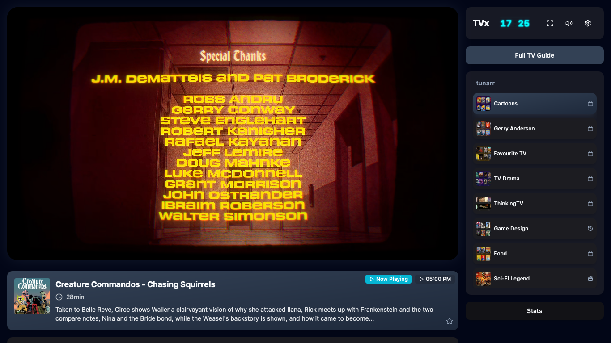
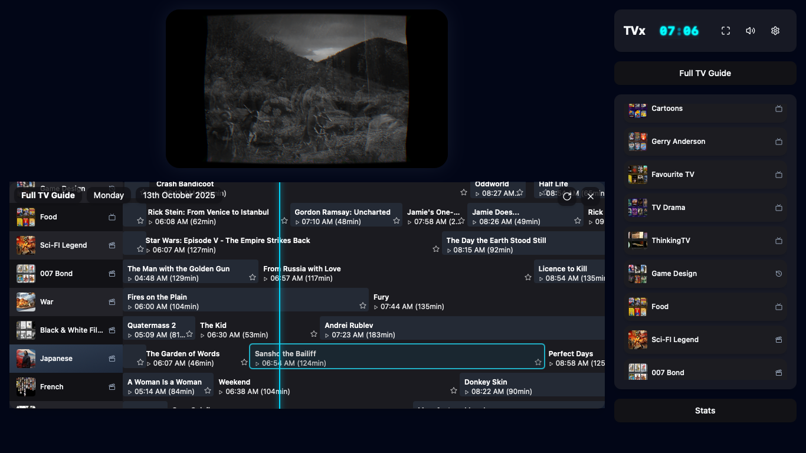
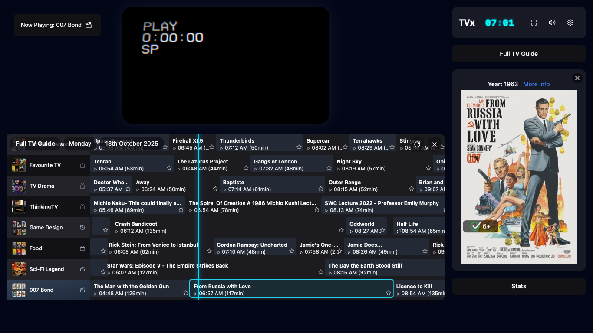
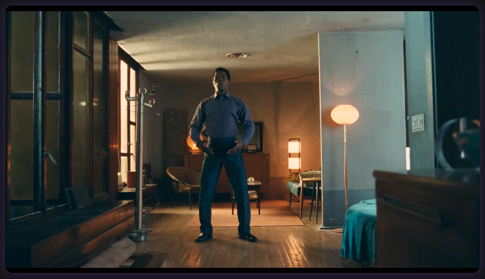
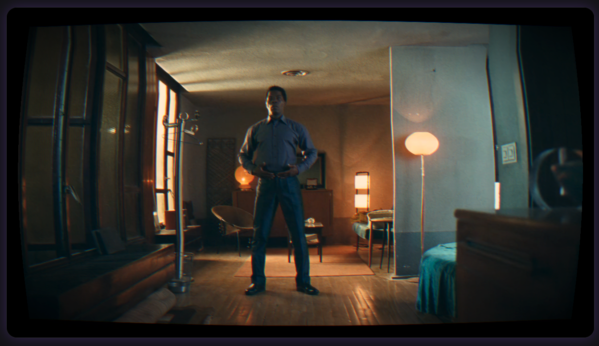

# 📺 TVx — the warmth of modern nostalgia

This is the way - television you remember feeling: present, unhurried, *analog*.

- ❤️‍🔥 TVx brings back the ritual of watching—not scrolling, not seeking, just *being* with what's on.
- 🎞️ Like the grain of 35mm film or the crackle before a record drops, it trades sterile perfection for something alive.
- 📟 Curved glass. Gentle flicker. Scanlines that breathe.
- 🎥 The soft bokeh of vintage anamorphic lenses —edges that blur like looking through aged glass, chromatic fringing that feels organic, not digital.
- ⏱️ The glow of a neon clock counting Saturday mornings long past.

## 🎯 What it does

An IPTV + EPG viewer for **Tunarr** (Plex/Jellyfin) playlists and XMLTV guides. Built for channel surfing, not catalog anxiety. Anti‑algorithm. Pro‑moment. Vibing.

**Architecture**: TVx is a client-side web frontend that interfaces with your **Tunarr backend** alongside your **Plex library**. It consumes M3U playlists and XMLTV EPG data generated by Tunarr, while displaying rich metadata and artwork from your Plex media server.

## ⚠️ Required: Allow TVx in Tunarr (CORS)

TVx runs in your browser and fetches the playlist, the guide and the video straight from Tunarr. Because TVx and Tunarr sit on different ports, that is a cross-origin request, and recent Tunarr versions block it by default.

**Add this environment variable to your _Tunarr_ container** (not TVx), then restart Tunarr:

```
TUNARR_CORS_ORIGINS=http://your-tvx-ip-address:8777
```

The value must be the address you open TVx at, exactly as it appears in your browser's address bar, with **no trailing slash**. Serving TVx at more than one address — a hostname as well as an IP, or through a reverse proxy — means listing each one, separated by commas:

```
TUNARR_CORS_ORIGINS=http://192.168.1.50:8777,https://tv.example.com
```

**Without this, TVx shows an empty channel list and no guide.** Press `F12` and look in the Console: a message about `No 'Access-Control-Allow-Origin' header` means this variable is missing or doesn't match.

Tunarr allowed any origin before a security fix in September 2026, so installs predating it worked without this step. Older Tunarr versions ignore the variable harmlessly — setting it is safe either way.

## 💾 Install

<details>
<summary><strong>🐳 Docker</strong></summary>

<br>

## ⚠️ Required: Configure Your IPTV Sources

**Before running TVx, you MUST set your M3U playlist and XMLTV EPG URLs using environment variables:**

- `VITE_M3U_URL` - Your IPTV M3U playlist URL
- `VITE_XMLTV_URL` - Your XMLTV EPG guide URL

**You must also set `TUNARR_CORS_ORIGINS` on your Tunarr container** — see [Allow TVx in Tunarr (CORS)](#%EF%B8%8F-required-allow-tvx-in-tunarr-cors) above. Without it, Tunarr refuses TVx's requests and the channel list stays empty.

**Example:**
```bash
docker run -d \
  --name tvx \
  -p 8777:80 \
  --restart unless-stopped \
  -e VITE_M3U_URL="http://your-tunarr-ip-address:8000/api/channels.m3u" \
  -e VITE_XMLTV_URL="http://your-tunarr-ip-address:8000/api/xmltv.xml" \
  ghcr.io/dopeytree/tvx:latest
```

**If you change URLs later, clear your browser cache** (Ctrl+Shift+R) to see the updates.

## Run with Docker

```bash
docker run -d \
  --name tvx \
  -p 8777:80 \
  --restart unless-stopped \
  -e VITE_M3U_URL="http://your-tunarr-ip-address:8000/api/channels.m3u" \
  -e VITE_XMLTV_URL="http://your-tunarr-ip-address:8000/api/xmltv.xml" \
  ghcr.io/dopeytree/tvx:latest
```

Then open <http://localhost:8777>

## Run with Docker Compose

```yaml
services:
  tvx:
    image: ghcr.io/dopeytree/tvx:latest
    ports:
      - "8777:80"
    restart: unless-stopped
    environment:
      - TZ=UTC
      - VITE_M3U_URL=http://your-tunarr-ip-address:8000/api/channels.m3u
      - VITE_XMLTV_URL=http://your-tunarr-ip-address:8000/api/xmltv.xml
    volumes:
      - ./config:/config
```

Save as `docker-compose.yml` and run:
```bash
docker-compose up -d
```

## Build locally

```bash
# Build the image
docker build -t tvx .

# Run it
docker run -d \
  -p 8777:80 \
  --name tvx \
  -e VITE_M3U_URL="http://your-tunarr-ip-address:8000/api/channels.m3u" \
  -e VITE_XMLTV_URL="http://your-tunarr-ip-address:8000/api/xmltv.xml" \
  tvx
```

**Tiny Alpine-based image** — Production-ready with nginx, gzip compression, and health checks built in.

</details>

<details>
<summary><strong>🖥️ Unraid</strong></summary>

## Search app store for `TVx` or manual install below
<br>

### ⚠️ Required: Set IPTV Source URLs

**Before installing, you MUST add environment variables for your M3U playlist and XMLTV EPG URLs:**

| Variable | Value |
|----------|-------|
| `VITE_M3U_URL` | `http://your-tunarr-ip-address:8000/api/channels.m3u` |
| `VITE_XMLTV_URL` | `http://your-tunarr-ip-address:8000/api/xmltv.xml` |

**Your Tunarr container also needs `TUNARR_CORS_ORIGINS` set to your TVx address** — see [Allow TVx in Tunarr (CORS)](#%EF%B8%8F-required-allow-tvx-in-tunarr-cors) above. On Unraid, edit the **Tunarr** container, click *Add another Path, Port, Variable, Label or Device*, set the type to **Variable**, the key to `TUNARR_CORS_ORIGINS` and the value to `http://YOUR-UNRAID-IP:8777`.

**If you change URLs later, clear your browser cache** (Ctrl+Shift+R) to see the updates.

## Unraid Manual Install

1. Open **Docker** tab in Unraid
2. Click **Add Container**
3. Fill in the following:

| Field | Value |
|-------|-------|
| **Name** | `tvx` |
| **Repository** | `ghcr.io/dopeytree/tvx:latest` |
| **Registry URL** | `https://github.com/dopeytree/TVx/pkgs/container/tvx` |
| **Icon URL** | `https://raw.githubusercontent.com/dopeytree/TVx/main/public/logo.png` |
| **WebUI** | `http://[IP]:[PORT:8777]` |
| **Port** | Container: `80`, Host: `8777` (or your preferred port) |
| **Network Type** | `Bridge` |

4. **Add the following environment variables:**
   - `VITE_M3U_URL` = `http://your-tunarr-ip-address:8000/api/channels.m3u`
   - `VITE_XMLTV_URL` = `http://your-tunarr-ip-address:8000/api/xmltv.xml`
   - `TZ` = `America/New_York` (or your timezone)

5. Click **Apply**
6. Access at: `http://YOUR-UNRAID-IP:8777`

**Persistent Configuration** — Mount a volume to `/config` and place a `settings.json` file there for persistent settings across container restarts.

**Note**: An official Unraid Community Apps template is coming soon for one-click installation!

</details>

<details>
<summary><strong>📚 Documentation</strong></summary>

[Full Documentation](https://dopeytree.github.io/TVx/) - Complete documentation index


</details>


## Main View



## Full TV Guide View



## Full TV Guide View + Poster



## Full screen (vintage filter off) View



## Full screen (vintage filter on) View



## Buy me a coffee

[](https://github.com/sponsors/dopeytree)
[](https://www.buymeacoffee.com/dopeytree)

## ✨ Why it feels different

- ⚡ **Instant channel surfing** — hold ↑/↓ to skim; land when something catches your eye
- 📟 **CRT warmth** — curvature, chromatic aberration, scanlines, vignette
- 📅 **Full TV guide** — press G for a 12‑hour timeline across all channels with poster artwork
- 🎬 **Theater modes** — click the player to cycle views (guide → normal → immersive)
- 📊 **Comprehensive logging** — All user interactions logged to Docker container for monitoring and debugging
- 🏷️ **Smart channel names** — strips filler words, adds icons:
  - *Pulp Fiction Movies* → Pulp Fiction [🎬]
  - *The Hitchhiker's Guide to the Galaxy Shows* → The Hitchhiker's Guide to the Galaxy [📺]
  - *Extreme Ironing Sports* → Extreme Ironing [🏆]
  - *The Tesla Files History* → The Tesla Files [📜]
  - *Cosmos Documentaries* → Cosmos [📜]


## 🚀 Quick start

- You need to have set up Plex/Jellyfin media server
- Tunarr or Dizquetv for channel streaming
- Configure your M3U and XMLTV URLs via Docker environment variables (see Docker section below)
- Set `TUNARR_CORS_ORIGINS` on your Tunarr container to your TVx address (see [CORS](#%EF%B8%8F-required-allow-tvx-in-tunarr-cors))
- Open - `http://localhost:8777`
- That's it
- Use the up/down arrow keys to browse your personal media

## 📚 Documentation

- [Full Documentation](https://dopeytree.github.io/TVx/) - Complete documentation index

## ⌨️ Keyboard shortcuts

| Key | Action |
|-----|--------|
| `↑` `↓` | Channel surf (hold to skim) |
| `G` | Toggle full TV guide |
| `F` | Fullscreen |
| `M` | Mute/Unmute |
| `Esc` | Close modals/Exit theater |

## 📊 Logging & Monitoring

TVx provides comprehensive logging of all user interactions directly to your Docker container logs, making it easy to monitor usage and troubleshoot issues in Unraid or other container environments.

**Docker Compose Logs:**
```bash
docker-compose logs -f tvx
```

### Sample Log Output

```log
2025-01-15 10:30:15 INFO: Opened: Program Popup for "Breaking Bad" on AMC
2025-01-15 10:30:20 INFO: Opened: Google Search for "Breaking Bad (2008)"
2025-01-15 10:30:25 INFO: Selected: Channel "HBO" in Sidebar
2025-01-15 10:30:30 INFO: Opened: Full TV Guide
2025-01-15 10:30:45 INFO: Closed: Program Popup
```

## 🛠️ Tech Stack

- ⚛️ **React 18** + **TypeScript** — Modern, type-safe UI
- ⚡ **Vite** — Lightning-fast build tool
- 🎨 **WebGL Fragment Shaders** — Custom CRT effects and visual processing
- 📡 **HLS.js** — Adaptive HTTP Live Streaming
- 🎭 **Radix UI** + **Tailwind CSS** — Accessible components, utility-first styling
- 🎯 **Lucide Icons** — Beautiful, consistent iconography

## 🌐 Browser Support

Works best in modern browsers with WebGL support:

- 🟢 Chrome/Edge 90+
- 🟠 Firefox 88+
- 🔵 Safari 14+

## 📜 License

PolyForm Noncommercial 1.0.0

This project is licensed under the [PolyForm Noncommercial License 1.0.0](https://polyformproject.org/licenses/noncommercial/1.0.0/). You are free to use, modify, and share this software for any noncommercial purpose. Commercial use requires a separate license.

**In brief**: Use it for joy, learn from it, fork it, improve it - just don't sell it or use it to make money without permission.

## 🤝 Contributing

This is a personal passion project, but contributions, suggestions, and feedback are welcome! Feel free to open issues or submit pull requests.


